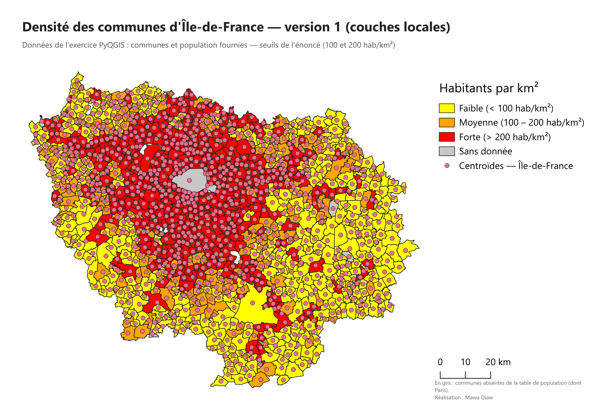
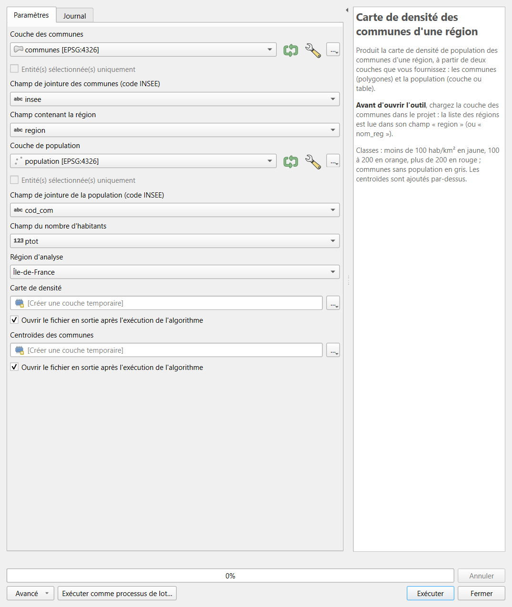

# Densité communale — version 1

**Script de traitement QGIS : la carte de densité des communes d'une région, à partir de vos propres couches.**

Vous fournissez une couche de **communes** et une couche de **population**, vous choisissez les champs de jointure et la **région** dans une liste déroulante : le script calcule la densité de chaque commune et produit la carte en trois classes, avec les centroïdes des communes.

> **Deux versions de ce projet existent.**
> - **Version 1 (ce dépôt)** — travaille sur des couches locales que vous chargez dans QGIS. C'est la version issue de l'exercice.
> - **Version 2 — [densite-communale](https://github.com/mawa399/densite-communale)** — plugin QGIS installable, qui télécharge lui-même les données officielles (API Géo) : aucune couche à fournir, régions et départements, trois classifications.

## Sommaire

- [Fonctionnalités](#fonctionnalités)
- [Installation](#installation)
- [Utilisation](#utilisation)
- [Données à utiliser](#données-à-utiliser)
- [Résultat](#résultat)
- [Comment ça marche](#comment-ça-marche)
- [Limites](#limites)
- [Origine du projet](#origine-du-projet)
- [Auteur et licence](#auteur-et-licence)

## Fonctionnalités

- **Vos propres données** : n'importe quelle couche de communes (polygones) et n'importe quelle couche ou table de population.
- **Jointure configurable** : vous choisissez le champ code INSEE de chaque couche et le champ du nombre d'habitants.
- **Liste déroulante des régions**, remplie automatiquement à partir de la couche des communes ouverte dans le projet.
- **Densité fiable** : surface mesurée sur l'ellipsoïde, juste quelle que soit la projection de la couche.
- **Carte prête à l'emploi** : jaune (moins de 100 hab/km²), orange (100 à 200), rouge (plus de 200), communes sans population en gris, centroïdes par-dessus.

## Installation

1. Téléchargez [`densite_communes_region.py`](densite_communes_region.py) (bouton *Download raw file* sur la page du fichier).
2. Dans QGIS, ouvrez la **boîte à outils de traitements** (Ctrl+Alt+T).
3. Cliquez sur l'icône **Python** en haut de la boîte, puis **Ajouter un script à la boîte à outils…** et choisissez le fichier.
4. L'outil apparaît dans *Scripts → Densité communale → Carte de densité des communes d'une région*.

Compatible **QGIS 3.34 et suivantes, et QGIS 4**. Aucune bibliothèque supplémentaire.

## Utilisation

1. **Chargez d'abord vos deux couches** dans le projet QGIS (communes et population).
2. Ouvrez l'outil : la liste *Région d'analyse* se remplit avec les régions de la couche des communes.
3. Vérifiez les champs proposés, choisissez la région, puis cliquez sur **Exécuter**.

> Si vous chargez la couche des communes **après** avoir ouvert l'outil, fermez-le et rouvrez-le pour mettre à jour la liste des régions.

| Paramètre | Valeur par défaut | Rôle |
|---|---|---|
| Couche des communes | — | Polygones des communes |
| Champ de jointure des communes | `insee` | Code INSEE de la commune |
| Champ contenant la région | `region` | Sert à filtrer la région choisie |
| Couche de population | — | Couche ou table des populations |
| Champ de jointure de la population | `cod_com` | Code INSEE dans la table de population |
| Champ du nombre d'habitants | `ptot` | Population de la commune |
| Région d'analyse | — | Liste déroulante |

## Données à utiliser

Les données de l'exercice d'origine ne sont **pas incluses** dans ce dépôt : elles sont trop volumineuses (plus de 300 Mo) et n'ont pas été produites par l'auteur.

Pour utiliser le script avec des données officielles et gratuites :

- **[Admin Express](https://geoservices.ign.fr/adminexpress)** (IGN) : la couche `COMMUNE` contient à la fois les contours, le code INSEE (`INSEE_COM`), le code de région (`INSEE_REG`) et la population (`POPULATION`). Vous pouvez donc l'utiliser **comme couche des communes et comme couche de population** : choisissez `INSEE_COM` pour les deux jointures, `INSEE_REG` comme champ de région et `POPULATION` comme nombre d'habitants. La liste affichera alors les codes de région (11 = Île-de-France, 53 = Bretagne…).
- **[Populations légales](https://www.insee.fr/fr/statistiques/7739582)** (INSEE, fichier d'ensemble) : si votre couche de communes n'a pas de population, joignez ce tableau sur le code INSEE.

## Résultat

Deux couches temporaires sont ajoutées au projet :

| Couche | Contenu |
|---|---|
| **Densité — *région*** | Communes de la région avec les champs d'origine, plus `habitants`, `surface_km2` et `densite` (hab/km²) |
| **Centroïdes — *région*** | Un point par commune, toujours situé à l'intérieur de celle-ci |

Sur les données de l'exercice, l'Île-de-France compte 1 270 communes : 475 en densité faible, 203 moyenne et 583 forte. Paris y apparaît en gris, car la table de population fournie ne contient pas sa population.

## Comment ça marche

1. **Population** : la couche de population est lue et indexée par code INSEE (équivalent d'une jointure attributaire).
2. **Région** : seules les communes de la région choisie sont conservées (équivalent d'une extraction par attribut).
3. **Densité** : surface ellipsoïdale de chaque commune, puis densité = habitants / surface en km².
4. **Centroïdes** : un point à l'intérieur de chaque commune.
5. **Style** : symbologie en trois classes et gris pour les communes sans population, appliquée au chargement ; les centroïdes sont placés au-dessus.

## Limites

- La liste des régions est construite **à l'ouverture de l'outil** : la couche des communes doit déjà être chargée.
- Les communes absentes de la table de population (communes fusionnées, données incomplètes) apparaissent en gris.
- Les seuils 100 et 200 hab/km² viennent de l'énoncé de l'exercice : ils distinguent bien les territoires ruraux, moins bien les grandes agglomérations, où presque tout est en rouge. La [version 2](https://github.com/mawa399/densite-communale) propose des classifications plus fines.

## Origine du projet

Ce script est la réécriture d'un exercice de PyQGIS réalisé en Master 2 Géomatique (Université Paris 8, 2024-2025) : *créer un outil qui produit la carte de densité des communes d'une région choisie par l'utilisateur*. Par rapport au rendu d'origine, il calcule les surfaces sur l'ellipsoïde, n'impose plus de noms de champs, affiche les communes sans population au lieu de les laisser en blanc, et suit les règles des algorithmes Processing.

## Auteur et licence

**Mawa Diaw** — Géomaticien / Développeur SIG · [GitHub](https://github.com/mawa399) · [LinkedIn](https://www.linkedin.com/in/mawa-diaw)

Distribué sous licence **GNU GPL v2 ou ultérieure** — voir [LICENSE](LICENSE).
